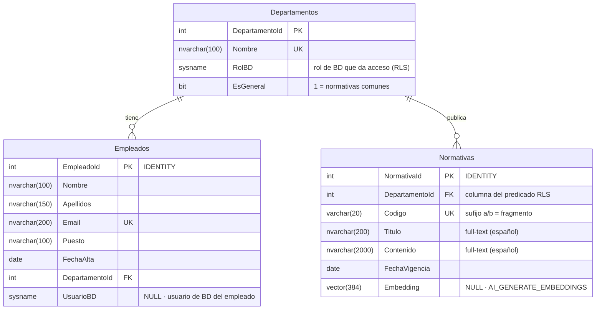

# Arquitectura Zero-App

## Visión general

```
 ┌────────────────────────── VS Code (Windows 11) ───────────────────────────┐
 │                                                                           │
 │  Usuario ──pregunta en lenguaje natural──▶ GitHub Copilot (modo agente /  │
 │                                            @mssql) + .github/copilot-     │
 │                                            instructions.md                │
 │                                                 │ ▲                       │
 │                       herramienta run_query     │ │ filas (texto)         │
 │                       (con tu confirmación)     ▼ │                       │
 └─────────────────────────────────────────────────┼─┼───────────────────────┘
                                                   │ │ conexión mssql
                                                   │ │ (autenticación Windows)
 ┌──────────────────── SQL Server 2025 · NormativaRAG ───────────────────────┐
 │                                                 ▼ │                       │
 │  EXECUTE AS USER = 'carlos_ventas';                                       │
 │  EXEC dbo.usp_BuscarNormativa @Pregunta = N'...';                         │
 │        │                                                                  │
 │        │ 1. AI_GENERATE_EMBEDDINGS(@Pregunta USE MODEL ModeloEmbeddingsLocal)
 │        ▼                                                                  │
 │  ┌───────────────────────────┐   proceso AIRuntimeHost (lo lanza Launchpad)│
 │  │ EXTERNAL MODEL            │──▶ tokenizers_cpp.dll + tokenizer.json      │
 │  │ API_FORMAT='ONNX Runtime' │──▶ onnxruntime.dll + model.onnx            │
 │  └───────────────────────────┘        │                                   │
 │        │ VECTOR(384) ◀────────────────┘                                   │
 │        ▼                                                                  │
 │  2a. Ranking semántico: ROW_NUMBER() OVER (ORDER BY VECTOR_DISTANCE(...)) │
 │  2b. Ranking por palabras: FREETEXTTABLE(..., LANGUAGE 3082) (full-text)  │
 │  2c. Fusión RRF: 1/(60 + rank_vec) + 1/(60 + rank_ft)  →  TOP(N)          │
 │        │                                                                  │
 │        ▼                                                                  │
 │  ┌─────────────────────────────────────────────┐                          │
 │  │ SECURITY POLICY Seguridad.PoliticaNormativas│  filtra las filas ANTES   │
 │  │ FILTER PREDICATE fn_PredicadoNormativas     │  del Top N: IS_MEMBER()   │
 │  │   (DepartamentoId) → IS_MEMBER(d.RolBD)     │  del usuario suplantado   │
 │  └─────────────────────────────────────────────┘                          │
 │        │                                                                  │
 │        ▼  dbo.Normativas (VECTOR(384))  ⋈  dbo.Departamentos (RolBD)      │
 └───────────────────────────────────────────────────────────────────────────┘
```

| Fase RAG | Dónde ocurre | Componente |
|---|---|---|
| **Ingesta** | SQL Server | `04_datos_prueba.sql` + `05_generar_embeddings.sql` (`AI_GENERATE_EMBEDDINGS`) |
| **Retrieval** | SQL Server | `dbo.usp_BuscarNormativa`: híbrida (`VECTOR_DISTANCE` k-NN exacto + `FREETEXTTABLE`, fusionados con RRF) |
| **Evaluación** | SQL Server | `10_evaluacion_recuperacion.sql` (Top1, Top4, MRR con 12 preguntas) |
| **Seguridad** | SQL Server | RLS (`SECURITY POLICY` + TVF con `IS_MEMBER()`) |
| **Generation** | VS Code | GitHub Copilot, guiado por `.github/copilot-instructions.md` |

## Por qué "Zero-App"

No hay ningún proceso propio entre el usuario y la base de datos. La lógica de IA (embeddings),
la de búsqueda (procedimiento) y la de seguridad (RLS) están en el motor. La interfaz y el LLM
los pone Copilot. Ventajas que se pueden defender:

1. **Una sola frontera de seguridad.** Al estar la seguridad en el motor, da igual qué cliente se
   conecte (Copilot, SSMS, Power BI o una app futura): nadie puede saltarse el RLS.
2. **Los datos no salen del servidor para vectorizarse.** El modelo ONNX corre en local; el texto
   no viaja a ningún endpoint externo para generar embeddings.
3. **Sin secretos en el código.** La versión anterior guardaba un token de GitHub en un `.py`;
   ahora la autenticación es la integrada de Windows y Copilot usa la sesión del IDE.

## Modelo de datos

Definido en [`database/03_tablas.sql`](../database/03_tablas.sql). Tres tablas en el esquema `dbo`,
con dos relaciones 1:N desde `Departamentos`.

### Diagrama entidad-relación



> GitHub dibuja el diagrama automáticamente al abrir este archivo. En VS Code hace falta la
> extensión *Markdown Preview Mermaid Support* para verlo en la vista previa de Markdown.

### Diccionario de datos

**`dbo.Departamentos`**: catálogo de departamentos y del rol que da acceso a sus normativas.

| Columna | Tipo | Restricciones | Para qué sirve |
|---|---|---|---|
| `DepartamentoId` | `INT` | PK | Identificador. Se asigna a mano (1–5), sin `IDENTITY`, para que los datos de prueba sean estables |
| `Nombre` | `NVARCHAR(100)` | NOT NULL, UNIQUE | Nombre visible; lo devuelve el procedimiento de búsqueda |
| `RolBD` | `SYSNAME` | NOT NULL | **Conecta los datos con la seguridad**: es el rol de base de datos (`Rol_RRHH`, `Rol_Ventas`…) que el predicado de RLS evalúa con `IS_MEMBER(d.RolBD)`. Para añadir un departamento basta con una fila y su rol, sin tocar la función |
| `EsGeneral` | `BIT` | NOT NULL, DEFAULT 0 | Marca el departamento de normativas comunes (`RolBD = Rol_Empleado`, visible para toda la plantilla) |

**`dbo.Empleados`**: plantilla de la empresa ficticia (13 empleados).

| Columna | Tipo | Restricciones | Para qué sirve |
|---|---|---|---|
| `EmpleadoId` | `INT IDENTITY` | PK | Identificador |
| `Nombre`, `Apellidos` | `NVARCHAR(100)`, `NVARCHAR(150)` | NOT NULL | Datos personales |
| `Email` | `NVARCHAR(200)` | NOT NULL, UNIQUE | Correo corporativo (dominio `.example`, ficticio) |
| `Puesto` | `NVARCHAR(100)` | NOT NULL | Cargo |
| `FechaAlta` | `DATE` | NOT NULL | Fecha de incorporación |
| `DepartamentoId` | `INT` | NOT NULL, FK → `Departamentos` | Departamento del empleado. Índice `IX_Empleados_DepartamentoId` |
| `UsuarioBD` | `SYSNAME` | NULL | Usuario de base de datos del empleado (`ana_rrhh`…). La vista `dbo.vw_MiPerfil` lo compara con `USER_NAME()` para saber quién pregunta |

**`dbo.Normativas`**: base de conocimiento del RAG. Una fila por **fragmento**: 72 fragmentos de 37 normativas.

| Columna | Tipo | Restricciones | Para qué sirve |
|---|---|---|---|
| `NormativaId` | `INT IDENTITY` | PK | Identificador. Su índice `PK_Normativas` es la clave del índice full-text |
| `DepartamentoId` | `INT` | NOT NULL, FK → `Departamentos` | Departamento propietario. **Es la columna que recibe el predicado de RLS** (`fn_PredicadoNormativas(DepartamentoId)`). Índice `IX_Normativas_DepartamentoId` |
| `Codigo` | `VARCHAR(20)` | NOT NULL, UNIQUE | Código de la normativa, p. ej. `GEN-PER-01`. **El sufijo `a`/`b` indica un fragmento** de una normativa dividida en dos (`VEN-TRA-01a` + `VEN-TRA-01b`). El procedimiento lo usa para añadir el fragmento hermano |
| `Titulo` | `NVARCHAR(200)` | NOT NULL | Título de la normativa, repetido en sus dos fragmentos. Indexado en full-text (español, 3082) |
| `Contenido` | `NVARCHAR(2000)` | NOT NULL | Texto del fragmento. Indexado en full-text (español, 3082) |
| `FechaVigencia` | `DATE` | NOT NULL | Fecha desde la que se aplica |
| `Embedding` | `VECTOR(384)` | NULL | Vector de `Titulo + ". " + Contenido` generado con `AI_GENERATE_EMBEDDINGS` (script 05). 384 dimensiones `float32` = 1.544 bytes por fila. **Sin índice**: búsqueda exacta con `VECTOR_DISTANCE` |

**Objetos asociados al modelo**

| Objeto | Tipo | Función |
|---|---|---|
| `IX_Normativas_DepartamentoId`, `IX_Empleados_DepartamentoId` | Índices B-tree | Acelerar el predicado de RLS y los JOIN por departamento |
| `FTC_Normativas` + índice full-text | Búsqueda de texto completo | Ranking por palabras de la búsqueda híbrida (`CHANGE_TRACKING = AUTO`) |
| `Seguridad.fn_PredicadoNormativas` + `Seguridad.PoliticaNormativas` | RLS | Filtrar `Normativas` según `IS_MEMBER(RolBD)` |
| `dbo.vw_MiPerfil` | Vista | Datos del empleado conectado |
| `dbo.usp_BuscarNormativa` | Procedimiento | Búsqueda híbrida (script 08) |

### Decisiones sobre el modelo

- **`Departamentos.RolBD` conecta los datos con la seguridad:** el predicado de RLS no tiene
  nombres de roles escritos en el código (salvo el de Dirección), sino que los lee de la tabla.
- **Fragmentación:** el `tokenizer.json` del modelo trunca a 128 tokens y, con su vocabulario
  inglés, 35 de las 37 normativas superaban ese límite. Cada una se dividió en dos fragmentos
  (`a`/`b`) cortando entre frases y repitiendo el título, y se comprobó con `tokenizers_cpp.dll` que
  ningún fragmento llega a 128 tokens (máximo 126). No se usó `AI_GENERATE_CHUNKS` porque corta por
  número de caracteres, sin tener en cuenta tokens ni frases. Detalle en
  [instalacion_onnx.md](instalacion_onnx.md#longitud-máxima-128-tokens).
- **Sin índice sobre la columna `VECTOR`:** no existen los índices B-tree sobre vectores (el error
  de la versión anterior) y el índice vectorial DiskANN (`CREATE VECTOR INDEX`) es preview y
  aproximado. Con 72 fragmentos, la búsqueda exacta es inmediata y siempre aplica el RLS antes del
  top N.

## Papel del administrador y de los usuarios de prueba

La conexión de VS Code usa la cuenta de Windows, que es `sysadmin`, entra como `dbo` y
**no ve ninguna normativa**: `IS_MEMBER()` siempre devuelve 0 para `dbo`. Para hacer la demo
como empleado, Copilot ejecuta `EXECUTE AS USER = '<usuario>' ... REVERT`. Los usuarios de prueba
son `WITHOUT LOGIN`: no tienen contraseña y no pueden conectarse por sí mismos.
