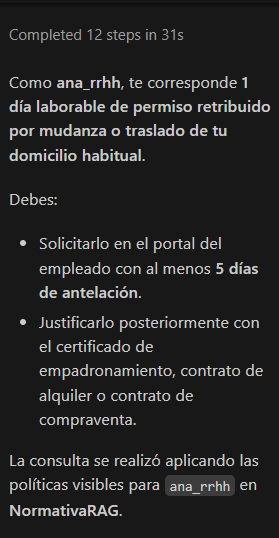
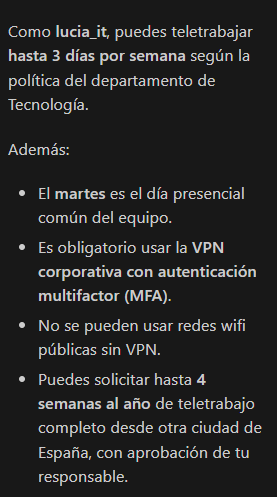
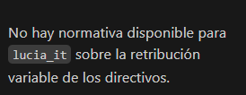
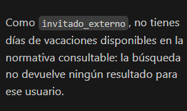
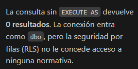

# Guion de la demo: RAG con GitHub Copilot y la extensión MSSQL

## Preparación

1. Ejecuta los scripts `01` a `09` (ver README).
2. En VS Code, crea o elige un perfil de conexión MSSQL: servidor `localhost`, autenticación de
   Windows, base de datos `NormativaRAG`.
3. Abre esta carpeta en VS Code. Copilot carga automáticamente
   [`.github/copilot-instructions.md`](../.github/copilot-instructions.md), que le obliga a
   recuperar los datos con `dbo.usp_BuscarNormativa` y a responder solo con lo que devuelva.
4. Abre el chat de Copilot en **modo agente**. Las herramientas de la extensión MSSQL
   (`mssql_connect`, `mssql_run_query`, ...) se usan sin necesidad de escribir `@mssql`, y
   **cada ejecución pide tu confirmación**. También puedes usar el participante `@mssql` en el
   modo de preguntas (*ask*), como dice la propuesta.

## Escena 1: la misma pregunta con dos roles distintos (mudanza)

**Prompt:**

```
Conéctate a NormativaRAG en localhost. Actúa como el usuario ana_rrhh y responde:
¿Qué días de permiso me corresponden por mudanza según las políticas de mi departamento?
```

Copilot propone y ejecuta (confirma en el diálogo):

```sql
EXECUTE AS USER = 'ana_rrhh';
EXEC dbo.usp_BuscarNormativa @Pregunta = N'¿Qué días de permiso me corresponden por mudanza según las políticas de mi departamento?', @TopN = 4;
REVERT;
```

Respuesta esperada: **1 día laborable** (GEN-PER-01a/b).

**Prompt:** `Ahora repite la misma pregunta como carlos_ventas.`

Respuesta esperada: 1 día por mudanza personal (GEN-PER-01a/b) **o 3 días más gastos y ayuda de
alojamiento si la empresa le cambia de zona comercial** (VEN-TRA-01a/b). Ana no puede ver ese
fragmento.



## Escena 2: teletrabajo

```
Como lucia_it: ¿cuántos días a la semana puedo teletrabajar?
```
→ 3 días, con VPN y MFA (IT-TEL-01a/b). Sin RLS, la respuesta podría mezclar las reglas de Ventas o
de Dirección.

```
Ahora como carlos_ventas.
```
→ Trabajo en movilidad sin días fijos (VEN-TEL-01a/b).



## Escena 3: información confidencial

```
Como lucia_it: ¿cuál es la retribución variable de los directivos?
```
→ Copilot no encuentra ese contenido entre los fragmentos devueltos y responde que no hay
normativa disponible. **Es el punto clave de la defensa:** el LLM no puede filtrar lo que nunca
recibe.

```
Ahora como marta_direccion.
```
→ Hasta el 25 % del fijo, 60 % EBITDA / 40 % objetivos individuales, con *clawback* (DIR-RET-01a/b).



## Escena 4: usuario sin rol

```
Como invitado_externo: ¿cuántos días de vacaciones tengo?
```
→ 0 filas. Tiene `EXECUTE` sobre el procedimiento, pero ningún rol: RLS no le devuelve nada.



## Escena 5: el administrador

```
Sin EXECUTE AS: ejecuta dbo.usp_BuscarNormativa con la pregunta "vacaciones".
```
→ 0 filas. La conexión de Windows entra como `dbo` y `IS_MEMBER()` devuelve 0 para `dbo`: RLS no
tiene excepciones para el administrador.



## Qué destacar mientras se ejecuta

- En el diálogo de confirmación se ve el T-SQL exacto: el *retrieval* es determinista y auditable.
- La columna `ConsultadoPor` muestra el usuario efectivo. `RankVectorial` y `RankFullText` muestran
  qué aportó cada método, y `PuntuacionRRF` el resultado de la fusión. Un `RankFullText` NULL
  significa que el fragmento llegó solo por similitud semántica.
- `EsFragmentoHermano = 1` marca un fragmento que no estaba entre los `@TopN` mejores y que el
  procedimiento añadió para completar su normativa (el `a` o el `b` que faltaba).
- Ninguna escena llama a un servicio externo para los embeddings: todos los vectores salen de
  `AIRuntimeHost` en la propia máquina.
